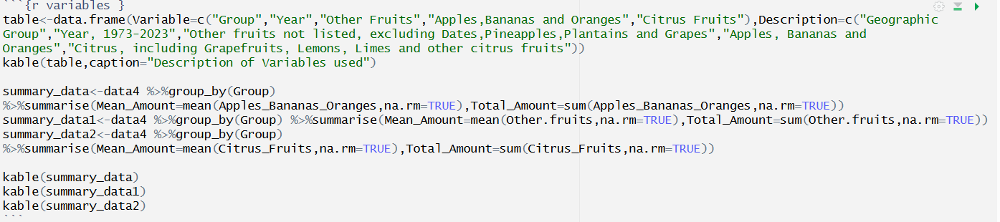

```{r setup, include=FALSE}
knitr::opts_chunk$set(echo = TRUE)
library(tidyverse)
library(knitr)
library(ggplot2)
data0<-read.csv("Data/fruit-consumption-by-fruit-type.csv")
data1<- data0 %>% mutate (Citrus_Fruits=Grapefruit+Citrus..other+Lemons.and.limes,Apples_Bananas_Oranges=Apples+Oranges+Bananas)

data2<-data1 %>% select (-Dates, -Grapefruit,-Citrus..other,-Lemons.and.limes,-Pineapples,-Plantains,-Grapes,-Apples,-Bananas,-Oranges,-Code)
data3<- rename(data2, Group=Entity) 
data4<-data3%>%filter(Group!="World")

```

## Research Question- How does fruit consumption differ globally?


The purpose of this analysis is to examine the differences in fruit consumption globally across the time period of the last 50 years. Specifically, the consumption of different groups of fruit will be analysed in relation to different geographic groups, across continents and different income levels. 

## Data

The dataset used in this analysis is from Our World in Data, with original data from FAOSTAT (Food and Agriculture Organization of the United Nations)(Food and Agriculture Organization of the United Nations,n.d). The raw data contained 561 rows, with 14 variables. To reduce the dataset to the size specified for this analysis (at least 3 numerical variables and no more than 5 overall), similar fruits were grouped and the remaining columns were dropped. 

### Variables

For the purpose of this analysis, two new groups of fruits were created (Citrus and Apples, Bananas and Oranges) by combining existing variables, with the remaining variables (excluding 'Other Fruits') being dropped (Geographic code, Dates, Plantains, Pineapples and Grapes). The rationale behind using these groups was that it included fruits that seemed to the most common (Apples, Bananas, Oranges), a wider group that combined a range of similar existing variables (Citrus, which combined three original variables) and a category that was already present in the raw data that encompassed various other fruits that have not been listed separately. The remaining variables represented geographic area (with the raw data being pre sorted into continent and income group from Our World in Data and FAOSTAT) and the year. 

`The raw data contained 561 observations with 14 variables, and the final dataset that will be used for analysis contains 510 observations, across 5 variables, as the 'World' group was removed.`

```{r code, echo=FALSE}

str(data4)
```


```{r variables, echo=FALSE }
library(kableExtra)
table<-data.frame(Variable=c("Group","Year","Other Fruits","Apples,Bananas and Oranges","Citrus Fruits"),Description=c("Geographic Group","Year, 1973-2023","Other fruits not listed, excluding Dates,Pineapples,Plantains and Grapes (kg per capita per year)","Apples, Bananas and Oranges (kg per capita per year)","Citrus, including Grapefruits, Lemons, Limes and other citrus fruits (kg per capita per year"))
kable(table,caption="Description of Variables used")

summary_data<-data4 %>%group_by(Group) %>%summarise(Mean_Amount=mean(Apples_Bananas_Oranges,na.rm=TRUE),Total_Amount=sum(Apples_Bananas_Oranges,na.rm=TRUE))
summary_data1<-data4 %>%group_by(Group) %>%summarise(Mean_Amount=mean(Other.fruits,na.rm=TRUE),Total_Amount=sum(Other.fruits,na.rm=TRUE))
summary_data2<-data4 %>%group_by(Group) %>%summarise(Mean_Amount=mean(Citrus_Fruits,na.rm=TRUE),Total_Amount=sum(Citrus_Fruits,na.rm=TRUE))

kable(summary_data,caption = "Mean and Sum of Apples, Bananas and Oranges")
kable(summary_data1,caption = "Mean and Sum of Other Fruit")
kable(summary_data2,caption = "Mean and Sum of Citrus Fruits")

table_data<-data4 %>% mutate(Decades=cut(Year,breaks=seq(1970,2030,by=10),dig.lab=4,right=FALSE))%>%group_by(Decades,Group) %>%summarise(Average=mean(Apples_Bananas_Oranges,na.rm=TRUE, .groups='drop'))%>%pivot_wider(names_from=Group,values_from=Average)

kable(table_data,caption="Comparison of Fruit (Apples, Bananas and Oranges) Consumption over Time",digits=2) %>% footnote(general= "The dataset only includes data up to and including 2023.")
```
### Analysis of Data

The summary statistics above highlight that the fruit group of Apples,Oranges and Bananas had the highest mean and sum, with Citrus fruits having the lowest, significantly less than the other groups analysed.**Generally, North America had the highest amounts of fruit consumption (First globally among Apples,Bananas Oranges and Citrus fruit,and second overall in Other Fruits), whilst Africa and Asia tended to have the lowest (with the exception of Citrus Fruits in Africa).** 

The consumption of Apples, Bananas and Oranges have steadily increased over the last 50 years across Africa, Asia and Europe. North America and Oceania displayed more fluctuations from decade to decade, however still had an upward trend. On the other hand, the level of consumption followed a downwards trend in South America, with most recent amounts being less than the averages from 1973-2000.This was also true for low income countries, with remaining income groups showing an upwards trend. 

```{r pressure, echo=FALSE}

ggplot(data=data4,aes(x=Apples_Bananas_Oranges,y=Citrus_Fruits,color=Group))+geom_point(size=2)+theme_minimal()+labs(title="Relationship between Apples,Bananas and Oranges and Citrus Fruits")
ggplot(data=data4,aes(x=Other.fruits,y=Citrus_Fruits,color=Group))+geom_point(size=2)+theme_minimal()+labs(title="Relationship between Other Fruits and Citrus Fruits")

```

The first plot above highlights a relatively strong positive relationship between Apples,Bananas, Oranges and Citrus Fruits, with North America having the highest amount of both fruit groups. *Most geographic groups had a proportionate amount of both fruit groups, with the exception of Africa (who had higher levels of citrus fruit) and Oceania (who had higher levels of Apples, Bananas and Oranges)* 

The next plot highlights a similar positive trend between Other fruits and citrus fruits, however data points are more clustered together along the slope line and more geographic groups displayed a linear trend as opposed to a cluster shape. As with the previous plot, North America had the highest levels of citrus fruit; however Oceania had the highest consumption of other fruit globally. Upper middle income countries had the highest consumption of other fruits, whilst high income countries were similar to lower-middle income countries. 

Given that other fruit includes berries, stone fruits and tropical fruits (Food and Agriculture Organization of the United Nations, n.d), local climates are expected to have a major influence in determining which more 'niche' fruits are grown and therefore consumed. 

## Conclusion

Analysis of the data highlights that Apples, Bananas and Oranges are the most common  group, followed by other fruit and citrus fruit. Analysis of Apples, Bananas and Oranges over time indicated that interestingly, consumption has not increased across every continent or income group.This was particularly prevalent in low income countries and in South America.

North America had a consistently high level of all three fruit groups, more than most continents. On the other hand, there was no single continent that consistently low levels of fruits. For example, although Africa had the lowest amounts of Apples, Bananas, Oranges and Other fruits, it had the third highest level of citrus fruit.

The relationship between Apples, Bananas, Oranges and Citrus fruits demonstrated a moderate, positive trend. This suggests that most groups had a somewhat proportionate level of consumption of the two groups. The exception to this trend was Africa and Oceania who had much higher consumption levels of only citrus or apples,bananas and oranges, respectively. When comparing citrus and other fruits, the relationship was similar, however the slope was generally more steep and resulted in almost three branches, with North America and South America showing a much stronger relationship than Oceania for example, which followed a slight downwards trend instead.

As expected, high income countries had generally the highest amounts of all fruits. This is likely to be attributed to the increased ability to import and perhaps grow a wider range of fruits, however more research is needed to confirm this assumption. Conversely, lower income countries had the lowest amounts of citrus and other fruits, however had a higher amount of Apples, Bananas and Oranges than lower-middle income countries. To provide more insight, future research could examine agricultural data in relation to geographic location to determine the drivers behind these levels of consumption. 

## References 

Food and Agriculture Organization of the United Nations (2025) – processed by Our World in Data. “Yearly per capita supply of dates” [dataset]. Food and Agriculture Organization of the United Nations, “Food Balances: Food Balances (-2013, old methodology and population)”; Food and Agriculture Organization of the United Nations, “Food Balances: Food Balances (2010–)” [original data]

Food and Agriculture Organization of the United Nations(n.d) *Food Balances (-2013,old methodology and population)*https://www.fao.org/faostat/en/#data/FBSH
Food and Agriculture Organization of the United Nations(n.d) *Food Balances (-2010)*https://www.fao.org/faostat/en/#data/FBS